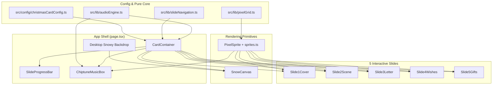

# Anime Pixel Art Christmas E-Card Implementation Plan

> **For agentic workers:** REQUIRED SUB-SKILL: Use superpowers:subagent-driven-development to implement this plan task-by-task. Steps use checkbox (`- [ ]`) syntax for tracking.

**Goal:** Build a mobile-first, 5-slide interactive Japanese Anime Pixel Art Christmas E-Card in Next.js (App Router), Tailwind CSS, and Framer Motion with zero external image assets and a synthesized Web Audio API *Silent Night* music box.

**Architecture:** A hybrid 32-bit rendering architecture combines low-resolution pixelated HTML5 Canvases (`imageSmoothingEnabled = false`) for continuous snow, clouds, fireworks, shooting stars, and flying hearts with crisp inline SVG Pixel-Grid Sprites (`shape-rendering="crispEdges"`) compiled from ASCII matrices for interactive characters, trees, windows, and love vouchers. All personalization lives in `src/config/christmasCardConfig.ts`, audio synthesis lives in `src/lib/audioEngine.ts`, and `CardContainer` orchestrates slide state, touch swipe, keyboard navigation, and active-slide lifecycle suspension.

**Architecture Diagram:**



**Tech Stack:** Next.js 15 (App Router), React 19, TypeScript 5, Tailwind CSS v4, Framer Motion 12, Web Audio API, HTML5 Canvas 2D, Vitest.

## Global Constraints

- Zero external image URLs or static `.png`/`.jpg` files: 100% Canvas (`imageSmoothingEnabled = false`) + inline SVG (`shape-rendering="crispEdges"`) + CSS pixel art (`image-rendering: pixelated`).
- Fonts loaded via `next/font/google`: `Pixelify_Sans` (`subsets: ["latin", "latin-ext"]`, `--font-pixel`) for English headings, numbers, and badges; `Space_Mono` (`subsets: ["latin", "vietnamese"]`, weights `["400", "700"]`, `--font-mono-vn`) for all Vietnamese copy and diacritics-safe headings.
- Palette: night gradient `#0b1026 -> #1e1b4b -> #312e81`, warm lantern gold `#fde047`, cream pixel border `#fef3c7`, primary text `#f8fafc`, warm rose `#f43f5e`, pine `#15803d`/`#4ade80`, VN backdrop `rgba(11, 16, 38, 0.80)` with `backdrop-blur`.
- Viewport lock: Mobile (`375px-430px`) full `100dvh`, zero vertical scrolling, zero horizontal overflow; Desktop centered `9:16` (`max-w-[430px]`, `h-[min(850px,92dvh)]`) framed over full-screen snowy sky.
- Touch targets: Primary buttons and `<` `>` / speaker buttons must be at least `44x44px`.
- Performance & Lifecycle: Every slide accepts `isActive: boolean` and pauses/cancels all `requestAnimationFrame` loops and timers when inactive or unmounted; `AudioContext` is cleanly closed on unmount.
- Windows PowerShell compatibility: Use `; if ($LASTEXITCODE -eq 0) { ... }` instead of `&&` when chaining commands in PowerShell 5.1.

---

### Task 1: Project Scaffolding, Fonts, Global Pixel Theme & Personalization Config

**Files:**
- Create: `package.json`, `tsconfig.json`, `next.config.ts`, `postcss.config.mjs`, `vitest.config.ts`, `.gitignore`
- Create: `src/app/globals.css`, `src/app/layout.tsx`, `src/app/page.tsx`
- Create: `src/config/christmasCardConfig.ts`
- Test: `src/config/__tests__/christmasCardConfig.test.ts`

**Interfaces:**
- Consumes: None (project root setup).
- Produces:
  - `GiftTicket` interface and `ChristmasCardConfig` interface + `christmasCardConfig` default object from `src/config/christmasCardConfig.ts`.
  - CSS utility classes `.pixel-border`, `.pixel-border-gold`, `.pixel-btn`, `.vn-panel`, `.pixelated`, `.perspective-1000`, `.preserve-3d`, `.backface-hidden`, `.rotate-y-180` in `src/app/globals.css`.
  - CSS font variables `--font-pixel` and `--font-mono-vn` attached to `<html>` in `src/app/layout.tsx`.

- [ ] **Step 1: Create project config files (`package.json`, `tsconfig.json`, `next.config.ts`, `postcss.config.mjs`, `vitest.config.ts`, `.gitignore`)**

`package.json`:
```json
{
  "name": "christmas-pixel-ecard",
  "version": "1.0.0",
  "private": true,
  "scripts": {
    "dev": "next dev",
    "build": "next build",
    "start": "next start",
    "lint": "next lint",
    "test": "vitest run",
    "test:watch": "vitest"
  },
  "dependencies": {
    "framer-motion": "^12.4.7",
    "next": "^15.2.3",
    "react": "^19.0.0",
    "react-dom": "^19.0.0"
  },
  "devDependencies": {
    "@tailwindcss/postcss": "^4.0.14",
    "@types/node": "^22.13.10",
    "@types/react": "^19.0.10",
    "@types/react-dom": "^19.0.4",
    "tailwindcss": "^4.0.14",
    "typescript": "^5.8.2",
    "vitest": "^3.0.8"
  }
}
```

`tsconfig.json`:
```json
{
  "compilerOptions": {
    "target": "ES2017",
    "lib": ["dom", "dom.iterable", "esnext"],
    "allowJs": true,
    "skipLibCheck": true,
    "strict": true,
    "noEmit": true,
    "esModuleInterop": true,
    "module": "esnext",
    "moduleResolution": "bundler",
    "resolveJsonModule": true,
    "isolatedModules": true,
    "jsx": "preserve",
    "incremental": true,
    "plugins": [{ "name": "next" }],
    "paths": {
      "@/*": ["./src/*"]
    }
  },
  "include": ["next-env.d.ts", "**/*.ts", "**/*.tsx", ".next/types/**/*.ts"],
  "exclude": ["node_modules"]
}
```

`next.config.ts`:
```ts
import type { NextConfig } from "next";

const nextConfig: NextConfig = {
  reactStrictMode: true,
};

export default nextConfig;
```

`postcss.config.mjs`:
```js
const config = {
  plugins: {
    "@tailwindcss/postcss": {},
  },
};

export default config;
```

`vitest.config.ts`:
```ts
import { defineConfig } from "vitest/config";
import path from "path";

export default defineConfig({
  test: {
    environment: "node",
    include: ["src/**/*.test.ts"],
  },
  resolve: {
    alias: {
      "@": path.resolve(__dirname, "./src"),
    },
  },
});
```

`.gitignore`:
```gitignore
node_modules/
.next/
out/
.env*.local
npm-debug.log*
.DS_Store
*.tsbuildinfo
next-env.d.ts
```

- [ ] **Step 2: Install npm dependencies**

Run: `npm install` (retry with `BypassSandbox: true` if sandbox blocks registry access).
Expected: `node_modules/` created cleanly with zero peer dependency failures.

- [ ] **Step 3: Write the failing test for `christmasCardConfig`**

`src/config/__tests__/christmasCardConfig.test.ts`:
```ts
import { describe, expect, it } from "vitest";
import { christmasCardConfig } from "../christmasCardConfig";

describe("christmasCardConfig", () => {
  it("provides required personalization defaults", () => {
    expect(christmasCardConfig.recipientName).toBe("[Tên người yêu]");
    expect(christmasCardConfig.senderName).toBe("[Tên của bạn]");
    expect(christmasCardConfig.coverTitle.length).toBeGreaterThan(0);
  });

  it("provides 3 chibi quotes, 3-4 letter pages, 5 shooting star wishes, and 3 gift tickets", () => {
    expect(christmasCardConfig.chibiQuotes).toHaveLength(3);
    expect(christmasCardConfig.letterPages.length).toBeGreaterThanOrEqual(3);
    expect(christmasCardConfig.letterPages.length).toBeLessThanOrEqual(4);
    expect(christmasCardConfig.shootingStarWishes).toHaveLength(5);
    expect(christmasCardConfig.giftTickets).toHaveLength(3);

    for (const ticket of christmasCardConfig.giftTickets) {
      expect(ticket.id.length).toBeGreaterThan(0);
      expect(ticket.badge.length).toBeGreaterThan(0);
      expect(ticket.title.length).toBeGreaterThan(0);
      expect(ticket.subtitle.length).toBeGreaterThan(0);
      expect(["food", "hug", "wish"]).toContain(ticket.icon);
    }
  });
});
```

- [ ] **Step 4: Run test to verify it fails**

Run: `npx vitest run src/config/__tests__/christmasCardConfig.test.ts`
Expected: FAIL because `../christmasCardConfig` does not exist yet.

- [ ] **Step 5: Implement `src/config/christmasCardConfig.ts`, `src/app/globals.css`, `src/app/layout.tsx`, and minimal `src/app/page.tsx`**

`src/config/christmasCardConfig.ts`:
```ts
export type GiftIconKind = "food" | "hug" | "wish";

export interface GiftTicket {
  id: string;
  badge: string;
  title: string;
  subtitle: string;
  icon: GiftIconKind;
  accentColor: string;
}

export interface ChristmasCardConfig {
  recipientName: string;
  senderName: string;
  coverTitle: string;
  chibiQuotes: string[];
  letterPages: string[];
  shootingStarWishes: string[];
  giftTickets: GiftTicket[];
}

export const christmasCardConfig: ChristmasCardConfig = {
  recipientName: "[Tên người yêu]",
  senderName: "[Tên của bạn]",
  coverTitle: "Giáng Sinh An Lành",
  chibiQuotes: [
    "Lạnh quá, lại đây ôm một cái thật chặt nào!",
    "Noel năm nay có em ở bên là ấm áp nhất!",
    "Tay em lạnh rồi nè, để anh nắm giữ cả mùa đông nhé!",
  ],
  letterPages: [
    "Gửi em giữa đêm Noel se lạnh, cảm ơn em vì suốt một năm qua đã luôn dịu dàng, kiên nhẫn và mang thật nhiều ánh nắng vào những ngày bình thường nhất của anh.",
    "Ngoài kia gió đông có thể lạnh, nhưng chỉ cần nghĩ đến nụ cười và những câu chuyện nhỏ xíu của tụi mình, lòng anh lúc nào cũng thấy ấm như cầm một ly cacao nóng.",
    "Chúc em một mùa Giáng Sinh thật bình yên, ngủ ngon mỗi tối, ăn thật nhiều món em thích và luôn cảm nhận được rằng em được thương rất nhiều.",
    "Mong rằng không chỉ Noel này mà thật nhiều mùa đông sau nữa, tụi mình vẫn sẽ cùng nhau đi dưới đèn đường vàng ấm và đón những điều ngọt ngào nhất.",
  ],
  shootingStarWishes: [
    "Ước cho mọi muộn phiền của em đều tan nhẹ như bông tuyết đêm nay.",
    "Hứa sẽ luôn lắng nghe em kể chuyện, dù là chuyện to hay nhỏ xíu.",
    "Chúc em luôn rạng rỡ, mạnh khỏe và bình an trong từng khoảnh khắc.",
    "Hứa sẽ dẫn em đi ăn thật nhiều món ngon mỗi khi em thèm nhé!",
    "Ước tụi mình sẽ cùng nhau viết thêm thật nhiều kỷ niệm đẹp năm tới.",
  ],
  giftTickets: [
    {
      id: "ticket-food",
      badge: "TICKET 01",
      title: "1 Chầu Ăn Ngon Tùy Chọn",
      subtitle: "Em chỉ cần chọn quán, mọi thứ còn lại để anh lo hết!",
      icon: "food",
      accentColor: "#fde047",
    },
    {
      id: "ticket-hug",
      badge: "TICKET 02",
      title: "1 Cái Ôm Siêu Chặt",
      subtitle: "Sạc đầy pin ấm áp, dùng không giới hạn thời gian.",
      icon: "hug",
      accentColor: "#fb7185",
    },
    {
      id: "ticket-wish",
      badge: "TICKET 03",
      title: "1 Điều Ước Bất Kỳ",
      subtitle: "Thẻ đặc quyền — em muốn gì anh cũng cố gắng chiều!",
      icon: "wish",
      accentColor: "#38bdf8",
    },
  ],
};
```

`src/app/globals.css`:
```css
@import "tailwindcss";

:root {
  --sky-deep: #0b1026;
  --sky-mid: #1e1b4b;
  --sky-horizon: #312e81;
  --lamp-gold: #fde047;
  --lamp-amber: #f59e0b;
  --cream-ink: #fef3c7;
  --snow-white: #f8fafc;
  --rose-warm: #f43f5e;
  --rose-deep: #be123c;
  --pine-bright: #4ade80;
  --pine-deep: #15803d;
  --vn-bg: rgba(11, 16, 38, 0.82);
}

@theme inline {
  --font-pixel: var(--font-pixel);
  --font-mono-vn: var(--font-mono-vn);
}

html,
body {
  height: 100%;
  margin: 0;
  padding: 0;
  overflow: hidden;
  overflow-x: clip;
  background-color: var(--sky-deep);
  color: var(--snow-white);
  font-family: var(--font-mono-vn), monospace;
  -webkit-tap-highlight-color: transparent;
  user-select: none;
}

.font-pixel-display {
  font-family: var(--font-pixel), var(--font-mono-vn), monospace;
}

.font-vn-body {
  font-family: var(--font-mono-vn), monospace;
}

.pixelated {
  image-rendering: pixelated;
  image-rendering: crisp-edges;
}

.anime-sky-gradient {
  background: linear-gradient(
    180deg,
    var(--sky-deep) 0%,
    var(--sky-mid) 56%,
    var(--sky-horizon) 100%
  );
}

/* Stepped 32-bit Visual Novel frame border */
.pixel-frame {
  box-shadow:
    0 -3px 0 0 var(--cream-ink),
    0 3px 0 0 var(--cream-ink),
    -3px 0 0 0 var(--cream-ink),
    3px 0 0 0 var(--cream-ink),
    0 0 0 3px #1e1b4b,
    0 0 32px rgba(253, 224, 71, 0.14);
}

.vn-panel {
  background: var(--vn-bg);
  backdrop-filter: blur(8px);
  -webkit-backdrop-filter: blur(8px);
  box-shadow:
    0 -2px 0 0 var(--cream-ink),
    0 2px 0 0 var(--cream-ink),
    -2px 0 0 0 var(--cream-ink),
    2px 0 0 0 var(--cream-ink),
    inset 0 0 0 2px rgba(253, 224, 71, 0.24),
    0 6px 0 0 rgba(11, 16, 38, 0.72);
}

.vn-panel-gold {
  background: rgba(17, 24, 54, 0.88);
  backdrop-filter: blur(8px);
  -webkit-backdrop-filter: blur(8px);
  box-shadow:
    0 -2px 0 0 var(--lamp-gold),
    0 2px 0 0 var(--lamp-gold),
    -2px 0 0 0 var(--lamp-gold),
    2px 0 0 0 var(--lamp-gold),
    inset 0 0 0 2px rgba(254, 243, 199, 0.28),
    0 6px 0 0 rgba(11, 16, 38, 0.75);
}

.pixel-btn {
  position: relative;
  display: inline-flex;
  align-items: center;
  justify-content: center;
  gap: 0.5rem;
  min-width: 44px;
  min-height: 44px;
  background-color: var(--rose-warm);
  color: var(--snow-white);
  font-weight: 700;
  box-shadow:
    0 -2px 0 0 var(--cream-ink),
    0 2px 0 0 var(--cream-ink),
    -2px 0 0 0 var(--cream-ink),
    2px 0 0 0 var(--cream-ink),
    inset 0 -4px 0 0 var(--rose-deep),
    0 5px 0 0 rgba(11, 16, 38, 0.7);
  transition: transform 90ms steps(2), filter 120ms ease;
  cursor: pointer;
}

.pixel-btn:hover:not(:disabled) {
  filter: brightness(1.08);
}

.pixel-btn:active:not(:disabled) {
  transform: translateY(2px);
  box-shadow:
    0 -2px 0 0 var(--cream-ink),
    0 2px 0 0 var(--cream-ink),
    -2px 0 0 0 var(--cream-ink),
    2px 0 0 0 var(--cream-ink),
    inset 0 -2px 0 0 var(--rose-deep),
    0 2px 0 0 rgba(11, 16, 38, 0.7);
}

.pixel-btn:focus-visible,
.pixel-btn-ghost:focus-visible {
  outline: 2px solid var(--lamp-gold);
  outline-offset: 4px;
}

.pixel-btn:disabled,
.pixel-btn-ghost:disabled {
  opacity: 0.35;
  cursor: not-allowed;
}

.pixel-btn-ghost {
  position: relative;
  display: inline-flex;
  align-items: center;
  justify-content: center;
  min-width: 44px;
  min-height: 44px;
  background-color: rgba(15, 23, 56, 0.84);
  color: var(--cream-ink);
  box-shadow:
    0 -2px 0 0 rgba(254, 243, 199, 0.85),
    0 2px 0 0 rgba(254, 243, 199, 0.85),
    -2px 0 0 0 rgba(254, 243, 199, 0.85),
    2px 0 0 0 rgba(254, 243, 199, 0.85),
    inset 0 -3px 0 0 rgba(11, 16, 38, 0.8);
  transition: transform 90ms steps(2), background-color 120ms ease;
  cursor: pointer;
}

.pixel-btn-ghost:hover:not(:disabled) {
  background-color: rgba(49, 46, 129, 0.9);
}

.pixel-btn-ghost:active:not(:disabled) {
  transform: translateY(2px);
}

/* 3D card flip helpers */
.perspective-1000 {
  perspective: 1000px;
}

.preserve-3d {
  transform-style: preserve-3d;
}

.backface-hidden {
  backface-visibility: hidden;
  -webkit-backface-visibility: hidden;
}

.rotate-y-180 {
  transform: rotateY(180deg);
}

@keyframes pixel-blink {
  0%, 49% { opacity: 1; }
  50%, 100% { opacity: 0.15; }
}

.animate-pixel-blink {
  animation: pixel-blink 1s steps(2, end) infinite;
}

@keyframes pixel-float {
  0%, 100% { transform: translateY(0px); }
  50% { transform: translateY(-6px); }
}

.animate-pixel-float {
  animation: pixel-float 2.8s ease-in-out infinite;
}

@media (prefers-reduced-motion: reduce) {
  .animate-pixel-float,
  .animate-pixel-blink {
    animation: none !important;
  }
}
```

`src/app/layout.tsx`:
```tsx
import type { Metadata, Viewport } from "next";
import { Pixelify_Sans, Space_Mono } from "next/font/google";
import "./globals.css";

const pixelifySans = Pixelify_Sans({
  subsets: ["latin", "latin-ext"],
  weight: ["400", "500", "600", "700"],
  variable: "--font-pixel",
  display: "swap",
});

const spaceMono = Space_Mono({
  subsets: ["latin", "vietnamese"],
  weight: ["400", "700"],
  variable: "--font-mono-vn",
  display: "swap",
});

export const metadata: Metadata = {
  title: "Thiệp Giáng Sinh Anime Pixel Art ✨",
  description: "Thiệp Giáng Sinh điện tử nhiều slide phong cách Anime Pixel Art 32-bit dành tặng người yêu.",
};

export const viewport: Viewport = {
  width: "device-width",
  initialScale: 1,
  maximumScale: 1,
  viewportFit: "cover",
  themeColor: "#0b1026",
};

export default function RootLayout({
  children,
}: Readonly<{
  children: React.ReactNode;
}>) {
  return (
    <html
      lang="vi"
      className={`${pixelifySans.variable} ${spaceMono.variable}`}
    >
      <body className="antialiased">{children}</body>
    </html>
  );
}
```

`src/app/page.tsx` (placeholder verified until Task 5 mounts `CardContainer`):
```tsx
import { christmasCardConfig } from "@/config/christmasCardConfig";

export default function HomePage() {
  return (
    <main className="anime-sky-gradient flex h-[100dvh] w-full items-center justify-center">
      <p className="font-pixel-display text-xl text-[#fde047]">
        {christmasCardConfig.coverTitle}
      </p>
    </main>
  );
}
```

- [ ] **Step 6: Run test and typecheck to verify Task 1 passes**

Run: `npx vitest run src/config/__tests__/christmasCardConfig.test.ts; if ($LASTEXITCODE -eq 0) { npx tsc --noEmit }`
Expected: 2 passing tests, 0 TypeScript errors.

- [ ] **Step 7: Commit**

```powershell
git add package.json package-lock.json tsconfig.json next.config.ts postcss.config.mjs vitest.config.ts .gitignore src/app src/config
git commit -m "feat: scaffold Next.js app, pixel CSS theme, Vietnamese fonts, and card config"
```

---

### Task 2: Pure Core Utilities — Pixel Grid Compiler & Slide Navigation Helpers

**Files:**
- Create: `src/lib/pixelGrid.ts`
- Test: `src/lib/__tests__/pixelGrid.test.ts`
- Create: `src/lib/slideNavigation.ts`
- Test: `src/lib/__tests__/slideNavigation.test.ts`

**Interfaces:**
- Consumes: None.
- Produces:
  - `PixelRect { x: number; y: number; width: number; height: number; fill: string }`
  - `CompiledPixelGrid { width: number; height: number; rects: PixelRect[] }`
  - `compilePixelGrid(rows: readonly string[], palette: Record<string, string>): CompiledPixelGrid`
  - `clampSlideIndex(index: number, totalSlides: number): number`
  - `detectSwipeDirection(dx: number, dy: number, minDistance?: number): -1 | 0 | 1` (returns `1` for swipe left -> next slide, `-1` for swipe right -> previous slide, `0` for tap/vertical noise)
  - `pickNextQuoteIndex(total: number, currentIndex: number | null, rng?: () => number): number`

- [ ] **Step 1: Write failing tests for `pixelGrid.ts` and `slideNavigation.ts`**

`src/lib/__tests__/pixelGrid.test.ts`:
```ts
import { describe, expect, it } from "vitest";
import { compilePixelGrid } from "../pixelGrid";

describe("compilePixelGrid", () => {
  it("merges adjacent horizontal pixels of the same color and skips transparent dots", () => {
    const grid = [".RR.", "R..B", "BBBB"];
    const palette = { R: "#f43f5e", B: "#312e81" };
    const result = compilePixelGrid(grid, palette);

    expect(result.width).toBe(4);
    expect(result.height).toBe(3);
    expect(result.rects).toEqual([
      { x: 1, y: 0, width: 2, height: 1, fill: "#f43f5e" },
      { x: 0, y: 1, width: 1, height: 1, fill: "#f43f5e" },
      { x: 3, y: 1, width: 1, height: 1, fill: "#312e81" },
      { x: 0, y: 2, width: 4, height: 1, fill: "#312e81" },
    ]);
  });

  it("handles empty grid safely", () => {
    expect(compilePixelGrid([], {})).toEqual({ width: 0, height: 0, rects: [] });
  });
});
```

`src/lib/__tests__/slideNavigation.test.ts`:
```ts
import { describe, expect, it } from "vitest";
import {
  clampSlideIndex,
  detectSwipeDirection,
  pickNextQuoteIndex,
} from "../slideNavigation";

describe("slideNavigation", () => {
  it("clamps slide indices within valid range", () => {
    expect(clampSlideIndex(-3, 5)).toBe(0);
    expect(clampSlideIndex(2, 5)).toBe(2);
    expect(clampSlideIndex(9, 5)).toBe(4);
    expect(clampSlideIndex(0, 0)).toBe(0);
  });

  it("distinguishes horizontal swipes from taps and vertical drags", () => {
    expect(detectSwipeDirection(-70, 10)).toBe(1);   // swipe left -> next
    expect(detectSwipeDirection(70, -8)).toBe(-1);   // swipe right -> prev
    expect(detectSwipeDirection(-30, 5)).toBe(0);    // too short (tap)
    expect(detectSwipeDirection(-65, 60)).toBe(0);   // too diagonal/vertical
  });

  it("picks a quote index without repeating the immediately previous index", () => {
    expect(pickNextQuoteIndex(1, 0)).toBe(0);
    expect(pickNextQuoteIndex(3, 1, () => 0)).toBe(0);
    expect(pickNextQuoteIndex(3, 1, () => 0.99)).toBe(2);
    expect(pickNextQuoteIndex(3, 0, () => 0)).toBe(1);
    expect(pickNextQuoteIndex(3, null, () => 0.5)).toBe(1);
  });
});
```

- [ ] **Step 2: Run tests to verify they fail**

Run: `npx vitest run src/lib/__tests__/pixelGrid.test.ts src/lib/__tests__/slideNavigation.test.ts`
Expected: FAIL because modules do not exist.

- [ ] **Step 3: Implement `src/lib/pixelGrid.ts` and `src/lib/slideNavigation.ts`**

`src/lib/pixelGrid.ts`:
```ts
export interface PixelRect {
  x: number;
  y: number;
  width: number;
  height: number;
  fill: string;
}

export interface CompiledPixelGrid {
  width: number;
  height: number;
  rects: PixelRect[];
}

export function compilePixelGrid(
  rows: readonly string[],
  palette: Readonly<Record<string, string>>
): CompiledPixelGrid {
  const height = rows.length;
  if (height === 0) {
    return { width: 0, height: 0, rects: [] };
  }

  let width = 0;
  const rects: PixelRect[] = [];

  for (let y = 0; y < height; y++) {
    const row = rows[y];
    if (row.length > width) width = row.length;

    let x = 0;
    while (x < row.length) {
      const ch = row[x];
      const fill = ch === "." || ch === " " ? undefined : palette[ch];
      if (!fill) {
        x++;
        continue;
      }

      let runEnd = x + 1;
      while (runEnd < row.length && row[runEnd] === ch) {
        runEnd++;
      }

      rects.push({
        x,
        y,
        width: runEnd - x,
        height: 1,
        fill,
      });
      x = runEnd;
    }
  }

  return { width, height, rects };
}
```

`src/lib/slideNavigation.ts`:
```ts
export function clampSlideIndex(index: number, totalSlides: number): number {
  if (totalSlides <= 0) return 0;
  return Math.max(0, Math.min(totalSlides - 1, Math.trunc(index)));
}

/**
 * Returns 1 for left swipe (next slide), -1 for right swipe (prev slide),
 * and 0 for small taps or vertical movement.
 */
export function detectSwipeDirection(
  dx: number,
  dy: number,
  minDistance = 55
): -1 | 0 | 1 {
  const absX = Math.abs(dx);
  const absY = Math.abs(dy);
  if (absX < minDistance) return 0;
  if (absX <= absY * 1.25) return 0;
  return dx < 0 ? 1 : -1;
}

export function pickNextQuoteIndex(
  total: number,
  currentIndex: number | null,
  rng: () => number = Math.random
): number {
  if (total <= 1) return 0;
  if (currentIndex === null || currentIndex < 0 || currentIndex >= total) {
    return Math.min(total - 1, Math.floor(rng() * total));
  }
  const candidate = Math.min(total - 2, Math.floor(rng() * (total - 1)));
  return candidate >= currentIndex ? candidate + 1 : candidate;
}
```

- [ ] **Step 4: Run tests to verify they pass**

Run: `npx vitest run src/lib/__tests__/pixelGrid.test.ts src/lib/__tests__/slideNavigation.test.ts`
Expected: PASS (all 5 tests green).

- [ ] **Step 5: Commit**

```powershell
git add src/lib/pixelGrid.ts src/lib/slideNavigation.ts src/lib/__tests__
git commit -m "feat: add pixel grid compiler and slide navigation helpers with unit tests"
```

---

### Task 3: Web Audio API Lo-Fi Music Box Engine (`Silent Night` + 8 SFX) & `ChiptuneMusicBox` UI

**Files:**
- Create: `src/lib/audioEngine.ts`
- Test: `src/lib/__tests__/audioEngine.test.ts`
- Create: `src/components/ChiptuneMusicBox.tsx`

**Interfaces:**
- Consumes: `PixelSprite` / speaker sprites (or inline crisp pixel SVG icon in `ChiptuneMusicBox` so Task 3 has zero circular dependency on Task 4).
- Produces:
  - `SfxType = "slide" | "click" | "firework" | "twinkle" | "heart" | "type" | "star" | "flip"`
  - `MusicBoxEngine` class (`start()`, `toggleMute()`, `setMuted(muted)`, `playSfx(type)`, `isPlaying()`, `isMuted()`, `dispose()`)
  - `ChiptuneMusicBox` component props: `{ isPlaying: boolean; isMuted: boolean; onToggle: () => void }`

- [ ] **Step 1: Write failing unit tests for `MusicBoxEngine`**

`src/lib/__tests__/audioEngine.test.ts`:
```ts
import { afterEach, describe, expect, it, vi } from "vitest";
import { MusicBoxEngine, type AudioContextFactory } from "../audioEngine";

function createMockAudioContext() {
  const oscillators: Array<{ type: string; frequency: { value: number }; started: boolean; stopped: boolean }> = [];
  const gains: Array<{ gain: { value: number } }> = [];

  const mockCtx = {
    state: "running" as AudioContextState,
    currentTime: 1.0,
    destination: {} as AudioDestinationNode,
    resume: vi.fn().mockResolvedValue(undefined),
    close: vi.fn().mockResolvedValue(undefined),
    createOscillator: vi.fn(() => {
      const osc = {
        type: "sine" as OscillatorType,
        frequency: {
          value: 440,
          setValueAtTime: vi.fn(),
          exponentialRampToValueAtTime: vi.fn(),
        },
        connect: vi.fn(),
        start: vi.fn(() => {
          osc.started = true;
        }),
        stop: vi.fn(() => {
          osc.stopped = true;
        }),
        started: false,
        stopped: false,
      };
      oscillators.push(osc);
      return osc as unknown as OscillatorNode;
    }),
    createGain: vi.fn(() => {
      const node = {
        gain: {
          value: 1,
          setValueAtTime: vi.fn(),
          linearRampToValueAtTime: vi.fn(),
          exponentialRampToValueAtTime: vi.fn(),
        },
        connect: vi.fn(),
      };
      gains.push(node);
      return node as unknown as GainNode;
    }),
    createBiquadFilter: vi.fn(() => ({
      type: "lowpass",
      frequency: { value: 2400 },
      Q: { value: 1 },
      connect: vi.fn(),
    })) as unknown as () => BiquadFilterNode,
  };

  return { mockCtx: mockCtx as unknown as AudioContext, oscillators, gains };
}

describe("MusicBoxEngine", () => {
  afterEach(() => {
    vi.useRealTimers();
  });

  it("lazily initializes AudioContext on start, schedules melody notes, and cleans up on dispose", () => {
    vi.useFakeTimers();
    const { mockCtx, oscillators } = createMockAudioContext();
    const factory: AudioContextFactory = vi.fn(() => mockCtx);
    const engine = new MusicBoxEngine(factory);

    expect(engine.isPlaying()).toBe(false);
    expect(factory).not.toHaveBeenCalled();

    engine.start();
    expect(factory).toHaveBeenCalledTimes(1);
    expect(engine.isPlaying()).toBe(true);
    expect(engine.isMuted()).toBe(false);
    expect(oscillators.length).toBeGreaterThan(0);

    engine.dispose();
    expect(engine.isPlaying()).toBe(false);
    expect(mockCtx.close).toHaveBeenCalledTimes(1);
  });

  it("toggles mute safely and suppresses SFX when muted", () => {
    const { mockCtx, oscillators } = createMockAudioContext();
    const engine = new MusicBoxEngine(() => mockCtx);

    engine.start();
    const countAfterStart = oscillators.length;

    engine.playSfx("heart");
    expect(oscillators.length).toBeGreaterThan(countAfterStart);

    const muted = engine.toggleMute();
    expect(muted).toBe(true);
    const countWhileMuted = oscillators.length;

    engine.playSfx("star");
    expect(oscillators.length).toBe(countWhileMuted);

    engine.dispose();
  });

  it("degrades silently when AudioContext construction throws", () => {
    const engine = new MusicBoxEngine(() => {
      throw new Error("Audio blocked");
    });

    expect(() => engine.start()).not.toThrow();
    expect(() => engine.playSfx("click")).not.toThrow();
    expect(engine.isPlaying()).toBe(false);
    expect(() => engine.dispose()).not.toThrow();
  });
});
```

- [ ] **Step 2: Run test to verify it fails**

Run: `npx vitest run src/lib/__tests__/audioEngine.test.ts`
Expected: FAIL because `../audioEngine` does not exist.

- [ ] **Step 3: Implement `src/lib/audioEngine.ts` and `src/components/ChiptuneMusicBox.tsx`**

`src/lib/audioEngine.ts`:
- Synthesizes **Silent Night (Stille Nacht)** in C major (3/4 waltz, ~84 BPM) using a dual-voice music-box patch: primary `triangle` + soft upper octave `sine` chime overtone + gentle warm `sine` bass harmony routed through a warm low-pass `BiquadFilterNode` (`2200Hz`) into a `masterGain` (`0.22`).
- Lookahead scheduler (`setInterval` at `80ms`, queuing notes `0.18s` ahead).
- Implements all 8 SFX cues: `slide`, `click`, `firework`, `twinkle`, `heart`, `type`, `star`, `flip`.
- Guards every Web Audio call cleanly with `try/catch` and closes `AudioContext` + clears timers in `dispose()`.

`src/components/ChiptuneMusicBox.tsx`:
- Renders a tactile `44×44px` `.pixel-btn-ghost` button with crisp inline SVG pixel speaker icon (speaker + animated gold soundwaves when playing & unmuted; speaker + red pixel `X` when muted/off) and accessible Vietnamese `aria-label` (`"Tắt nhạc nền"` / `"Bật nhạc nền"`).

- [ ] **Step 4: Run tests and typecheck to verify Task 3 passes**

Run: `npx vitest run src/lib/__tests__/audioEngine.test.ts; if ($LASTEXITCODE -eq 0) { npx tsc --noEmit }`
Expected: PASS (3 audio engine tests green, 0 TS errors).

- [ ] **Step 5: Commit**

```powershell
git add src/lib/audioEngine.ts src/lib/__tests__/audioEngine.test.ts src/components/ChiptuneMusicBox.tsx
git commit -m "feat: add Web Audio Silent Night music box synthesizer and ChiptuneMusicBox toggle"
```

---

### Task 4: 32-Bit Anime Pixel Art Library (`PixelSprite` & `sprites.ts`) + `SnowCanvas`

**Files:**
- Create: `src/components/pixel/PixelSprite.tsx`
- Create: `src/components/pixel/sprites.ts`
- Create: `src/components/SnowCanvas.tsx`

**Interfaces:**
- Consumes: `compilePixelGrid` from `src/lib/pixelGrid.ts`.
- Produces:
  - `PixelSprite` component (`grid: readonly string[]`, `palette: Readonly<Record<string, string>>`, `className?: string`, `title?: string`, `ariaHidden?: boolean`)
  - Sprite presets in `src/components/pixel/sprites.ts`:
    - `ENVELOPE_SPRITE` (28×20 pixel Christmas wax-sealed envelope with red heart stamp & pine sprig)
    - `CRESCENT_MOON_SPRITE` (16×16 warm golden crescent moon)
    - `TREE_GRID` + `TREE_PALETTES` (4 color themes: `warmGold`, `classicNoel`, `animePastel`, `winterRainbow` for the 24×32 multi-tier Christmas tree with star topper & garland)
    - `CHIBI_COUPLE_OPEN` & `CHIBI_COUPLE_BLINK` (32×26 cozy anime pixel couple — boy short dark hair + girl long chestnut hair, Santa hats, winter coats, red scarves, holding hands)
    - `CHIBI_AVATAR_OPEN` & `CHIBI_AVATAR_BLINK` (16×16 close-up Visual Novel portrait)
    - `COCOA_MUG_FRAME_A` & `COCOA_MUG_FRAME_B` (18×20 steaming hot cocoa mug with marshmallow + animated pixel steam)
    - `CANDLE_FRAME_A` & `CANDLE_FRAME_B` (8×14 warm flickering pixel candle)
    - `HEART_PIXEL_SPRITE` (11×10 crisp red/pink pixel heart with specular highlight)
    - `SPARKLE_SPRITE` (9×9 golden 4-point star)
    - `VOUCHER_ICONS` (`food`: pixel ramen/cake bowl, `hug`: twin pixel hearts/mittens, `wish`: pixel shooting star wand)
    - `CHEVRON_LEFT_SPRITE` & `CHEVRON_RIGHT_SPRITE` (9×11 pixel arrows)
  - `SnowCanvas` component props: `{ isActive?: boolean; variant?: "card" | "backdrop"; showClouds?: boolean; showStars?: boolean; className?: string }`

- [ ] **Step 1: Implement `src/components/pixel/PixelSprite.tsx`**

Memoizes `compilePixelGrid(grid, palette)` via `useMemo` and renders `<svg viewBox="0 0 W H" shapeRendering="crispEdges" className="pixelated ...">` with clean merged `<rect>` runs.

- [ ] **Step 2: Author `src/components/pixel/sprites.ts`**

Every sprite row has uniform width and authentic 32-bit shading (outline dark indigo `#0f172a`, midtone, highlight, warm rim light `#fde047`) so characters and props look handcrafted like a real Japanese pixel Visual Novel.

- [ ] **Step 3: Implement `src/components/SnowCanvas.tsx`**

- Renders onto a low-res virtual pixel grid (`216×384` for `"card"`, dynamically aspect-matched ~`320×180` for `"backdrop"`) with `ctx.imageSmoothingEnabled = false`.
- Draws:
  1. Twinkling pixel stars (1px & 2px cross stars pulsing at staggered phases).
  2. Slowly drifting layered indigo/lavender pixel clouds (`showClouds`).
  3. Two parallax layers of snow: tiny distant crisp flakes + larger foreground flakes surrounded by soft translucent warm/cool bokeh pixel halos.
- Pauses `requestAnimationFrame` immediately when `!isActive`, respects `window.matchMedia("(prefers-reduced-motion: reduce)")`, and cancels RAF on unmount.

- [ ] **Step 4: Run typecheck & tests**

Run: `npx tsc --noEmit; if ($LASTEXITCODE -eq 0) { npm test }`
Expected: 0 TypeScript errors, all existing tests pass.

- [ ] **Step 5: Commit**

```powershell
git add src/components/pixel src/components/SnowCanvas.tsx
git commit -m "feat: add 32-bit anime pixel sprite library and bokeh SnowCanvas"
```

---

### Task 5: `SlideProgressBar` & `CardContainer` Shell (Responsive 9:16 Frame, Swipe & Retro Transitions)

**Files:**
- Create: `src/components/SlideProgressBar.tsx`
- Create: `src/components/CardContainer.tsx`
- Modify: `src/app/page.tsx`

**Interfaces:**
- Consumes: `christmasCardConfig`, `clampSlideIndex`, `detectSwipeDirection`, `MusicBoxEngine`, `SnowCanvas`, `ChiptuneMusicBox`, `PixelSprite` (`CHEVRON_LEFT_SPRITE`, `CHEVRON_RIGHT_SPRITE`).
- Produces:
  - `SlideProps` shared interface: `{ isActive: boolean; config: ChristmasCardConfig; playSfx: (type: SfxType) => void }`
  - `SlideProgressBar` component (`totalSlides`, `activeSlide`, `onSelectSlide`)
  - `CardContainer` component managing `activeSlide`, `direction`, audio state (`isMusicPlaying`, `isMuted`), touch swipe, keyboard arrows, and rendering the 5 slides inside Framer Motion `AnimatePresence`.

- [ ] **Step 1: Implement `src/components/SlideProgressBar.tsx`**

5 segmented stepped pixel bars across the top safe area; completed segments glowing `#fde047`, active segment highlighted with crisp shimmer, upcoming segments translucent cream; each segment is a button allowing direct slide jump with accessible `aria-label="Chuyển tới slide N"`.

- [ ] **Step 2: Implement `src/components/CardContainer.tsx`**

- Mounts a single `MusicBoxEngine` ref, disposed cleanly in `useEffect` cleanup.
- Handles pointer/touch swipe (`onTouchStart`/`onTouchEnd` + mouse drag on non-interactive zones) via `detectSwipeDirection(dx, dy, 55)`.
- Handles keyboard `ArrowLeft` / `ArrowRight`.
- Top overlay bar: `SlideProgressBar` + `ChiptuneMusicBox` speaker toggle (`44×44px`).
- Bottom overlay bar: pixel `<` and `>` navigation buttons (`44×44px`) + crisp pixel counter (`01 / 05`), hidden/muted cleanly on Slide 1 until opened (or subtly usable at all times — keep `<` disabled on Slide 0 and `>` disabled on Slide 4 so user can freely browse both ways!).
- Framer Motion `AnimatePresence mode="wait"` directional slide-fade (`x: direction * 34`, `opacity: 0 -> 1`, `duration: 0.28`) plus subtle gold pixel shutter flash line.
- Temporarily mounts clean slide placeholders inside `CardContainer` until Tasks 6–8 wire each real slide component in.

- [ ] **Step 3: Update `src/app/page.tsx`**

Renders full-screen desktop ambient night sky (`anime-sky-gradient` + `SnowCanvas variant="backdrop"` hidden on small mobile where the card fills `100dvh`) and centers `CardContainer` (`w-full h-[100dvh] sm:h-[min(850px,92dvh)] sm:max-w-[430px] sm:pixel-frame`).

- [ ] **Step 4: Run typecheck & tests**

Run: `npx tsc --noEmit; if ($LASTEXITCODE -eq 0) { npm test }`
Expected: 0 TypeScript errors, all unit tests pass.

- [ ] **Step 5: Commit**

```powershell
git add src/components/SlideProgressBar.tsx src/components/CardContainer.tsx src/app/page.tsx
git commit -m "feat: add SlideProgressBar, responsive 9:16 CardContainer, and swipe/keyboard navigation"
```

---

### Task 6: Slide 1 (`Slide1Cover`) & Slide 2 (`Slide2Scene`)

**Files:**
- Create: `src/components/slides/Slide1Cover.tsx`
- Create: `src/components/slides/Slide2Scene.tsx`
- Modify: `src/components/CardContainer.tsx` (wire `Slide1Cover` and `Slide2Scene`)

**Interfaces:**
- Consumes: `SlideProps`, `PixelSprite`, sprites (`ENVELOPE_SPRITE`, `CRESCENT_MOON_SPRITE`, `TREE_GRID`, `TREE_PALETTES`, `CHIBI_COUPLE_OPEN`, `CHIBI_COUPLE_BLINK`, `HEART_PIXEL_SPRITE`), `pickNextQuoteIndex`.
- Produces:
  - `Slide1Cover` (`SlideProps & { onOpenCard: () => void }`)
  - `Slide2Scene` (`SlideProps`)

- [ ] **Step 1: Implement `src/components/slides/Slide1Cover.tsx`**

- Upper sky: glowing `CRESCENT_MOON_SPRITE` + twinkling pixel stars.
- Centerpiece: floating `.animate-pixel-float` wax-sealed Christmas envelope (`ENVELOPE_SPRITE`) with subtle warm golden halo.
- Typography: eyebrow badge (`coverTitle`), heading `"Merry Christmas,"` in `Pixelify Sans` + recipient name `config.recipientName + " ✨"` in bold Vietnamese-safe `Space Mono` (`#fde047`).
- Primary CTA: `.pixel-btn` `"Mở thiệp 💌"` (`min-h-[48px] px-7`):
  - On tap: disables double-tap, triggers `onOpenCard()` (starts *Silent Night* music box immediately inside user gesture), plays `firework` SFX, spawns a 650ms mini pixel firework particle burst on Slide 1's local low-res Canvas (`imageSmoothingEnabled = false`), then advances cleanly to Slide 2.
- Bottom snowbank & tiny pixel pine tree horizon silhouette.
- Cancels RAF & timeout cleanly if `!isActive` or unmounted.

- [ ] **Step 2: Implement `src/components/slides/Slide2Scene.tsx`**

- Cozy snowy Japanese winter park at night: warm pixel streetlamp on the left casting a soft radial amber cone (`#fde047`), snow ground with footprint details, subtle hint pill at top (*"Chạm vào cây thông hoặc cặp đôi nhé ✨"*).
- Interactive **Christmas Tree** `<button>`: displays `TREE_GRID` with current palette from 4 cycles (`Vàng Ấm`, `Noel Cổ Điển`, `Pastel Anime`, `Cầu Vồng`); subtle ornament twinkle frame toggle every `650ms` when `isActive`; tapping cycles color palette, flashes a brief light-mode pixel tag, and plays `twinkle` SFX.
- Interactive **Chibi Anime Couple** `<button>`: alternates `CHIBI_COUPLE_OPEN` / `CHIBI_COUPLE_BLINK` naturally when `isActive`; tapping spawns 4–5 floating `HEART_PIXEL_SPRITE` animations above their heads, plays `heart` SFX, and opens an Anime Visual Novel speech bubble displaying a non-repeating quote via `pickNextQuoteIndex(config.chibiQuotes.length, lastQuoteIdx)`.
- Cleans up all blink/twinkle/bubble timers when `!isActive` or unmounted.

- [ ] **Step 3: Wire `Slide1Cover` and `Slide2Scene` into `CardContainer.tsx`**

- [ ] **Step 4: Run typecheck & tests**

Run: `npx tsc --noEmit; if ($LASTEXITCODE -eq 0) { npm test }`
Expected: 0 TypeScript errors, all tests pass.

- [ ] **Step 5: Commit**

```powershell
git add src/components/slides/Slide1Cover.tsx src/components/slides/Slide2Scene.tsx src/components/CardContainer.tsx
git commit -m "feat: implement Slide1Cover (wax-seal envelope & fireworks) and Slide2Scene (interactive tree & chibi couple)"
```

---

### Task 7: Slide 3 (`Slide3Letter`) & Slide 4 (`Slide4Wishes`)

**Files:**
- Create: `src/components/slides/Slide3Letter.tsx`
- Create: `src/components/slides/Slide4Wishes.tsx`
- Modify: `src/components/CardContainer.tsx` (wire `Slide3Letter` and `Slide4Wishes`)

**Interfaces:**
- Consumes: `SlideProps`, `PixelSprite`, sprites (`CRESCENT_MOON_SPRITE`, `CHIBI_AVATAR_OPEN`, `CHIBI_AVATAR_BLINK`, `COCOA_MUG_FRAME_A`, `COCOA_MUG_FRAME_B`, `CANDLE_FRAME_A`, `CANDLE_FRAME_B`).
- Produces:
  - `Slide3Letter` (`SlideProps`)
  - `Slide4Wishes` (`SlideProps`)

- [ ] **Step 1: Implement `src/components/slides/Slide3Letter.tsx`**

- **Upper Window Scene (~42% height):** Warm wooden pixel window frame looking out onto the snowy sky & crescent moon, draped with warm twinkling pixel fairy lights across the top rail; wooden windowsill holding the animated steaming pixel cocoa mug (`COCOA_MUG_FRAME_A`/`B` alternating every `550ms` when `isActive`) and flickering candle (`CANDLE_FRAME_A`/`B`).
- **Lower Visual Novel Dialog (~58% height):** `.vn-panel` box containing:
  - Header row: framed blinking chibi avatar (`CHIBI_AVATAR_OPEN`/`BLINK`), sender badge (`config.senderName`), and page indicator (`{page + 1} / {total}`).
  - Body: `Space Mono` Vietnamese text revealed character-by-character (`28ms/char`, throttled soft `type` SFX every 4 chars) with fixed comfortable line-height so layout never jumps or overflows `375×667`.
  - Final page displays warm signature `— Gửi trọn yêu thương, {config.senderName}`.
  - Footer row: `"Hiện hết"` button (visible while typing; completes page instantly, `stopPropagation`) and blinking `▼` indicator (`"Chạm để đọc tiếp ▼"` / `"Đọc lại từ đầu ↺"`).
  - Tapping the dialog panel completes typing if in progress, otherwise advances to the next paragraph (wrapping cleanly from last page to page 0).
  - Pauses typewriter & blink intervals cleanly whenever `!isActive`.

- [ ] **Step 2: Implement `src/components/slides/Slide4Wishes.tsx`**

- **Panoramic Night Sky (~75% height):** Large glowing `CRESCENT_MOON_SPRITE`, faint pixel constellation stars, top floating guidance pill (*"Chạm lên bầu trời để thả sao băng & nhận lời chúc ✨"*) + wish counter badge (`{discovered}/{total}`).
- **Japanese Winter City Skyline (bottom edge):** Hand-crafted pixel SVG cityscape with pitched rooftops, power-line silhouette, and warm `#fde047` apartment windows that twinkle gently when `isActive`.
- **Interactive Shooting Star Canvas (`imageSmoothingEnabled = false`):**
  - Pointer/tap on the sky spawns a bright pixel shooting star arcing across the upper sky near the tap point with a fading golden-white pixelated tail and shimmering stardust pixels.
  - Plays `star` SFX and reveals an animated Visual Novel wish card near the bottom showing the next message from `config.shootingStarWishes` (cycles seamlessly so user can launch unlimited stars).
  - Suspends RAF loop when `!isActive` or when no active stars remain (zero idle CPU drain!).

- [ ] **Step 3: Wire `Slide3Letter` and `Slide4Wishes` into `CardContainer.tsx`**

- [ ] **Step 4: Run typecheck & tests**

Run: `npx tsc --noEmit; if ($LASTEXITCODE -eq 0) { npm test }`
Expected: 0 TypeScript errors, all tests pass.

- [ ] **Step 5: Commit**

```powershell
git add src/components/slides/Slide3Letter.tsx src/components/slides/Slide4Wishes.tsx src/components/CardContainer.tsx
git commit -m "feat: implement Slide3Letter (cozy cocoa VN typewriter) and Slide4Wishes (interactive shooting stars)"
```

---

### Task 8: Slide 5 (`Slide5Gifts`) Finale, Production Build & Browser Visual Verification

**Files:**
- Create: `src/components/slides/Slide5Gifts.tsx`
- Modify: `src/components/CardContainer.tsx` (wire `Slide5Gifts` + `onRestart`)

**Interfaces:**
- Consumes: `SlideProps`, `PixelSprite`, sprites (`VOUCHER_ICONS`, `SPARKLE_SPRITE`, `HEART_PIXEL_SPRITE`).
- Produces:
  - `Slide5Gifts` (`SlideProps & { onRestart: () => void }`)

- [ ] **Step 1: Implement `src/components/slides/Slide5Gifts.tsx`**

- Header: compact title `"Quà Bí Mật Cho Em 🎁"` + hint `"Chạm vào từng lá bài để lật mở ✨"`.
- **3 Flippable Anime Pixel Voucher Cards:**
  - Compact 3-row stack (each card ~`88px-98px` tall) so all 3 cards + header + action buttons fit effortlessly inside `375×667` with zero vertical overflow.
  - Front face (unflipped): starry indigo card with gold pixel corner trims, `ticket.badge` (`TICKET 01..03`), pixel sparkle emblem, and `"Chạm để lật"`.
  - Back face (flipped via `rotate-y-180` CSS 3D transition): warm illuminated border in `ticket.accentColor`, dedicated `VOUCHER_ICONS[ticket.icon]` pixel sprite, bold `ticket.title`, and `ticket.subtitle`.
  - Tapping a card flips it, plays `flip` SFX, and bursts pixel sparkles on Slide 5's local FX Canvas.
- **Finale Action Controls:**
  - **"Thả tim ❤️"** `.pixel-btn`: supports rapid continuous tapping; each tap spawns 6–9 multi-size rising pixel hearts across Slide 5's full-card low-res Canvas (`imageSmoothingEnabled = false`), plays `heart` SFX, and increments a cute counter badge (`+{heartCount}`).
  - **"Xem lại từ đầu ↺"** `.pixel-btn-ghost`: plays `click` SFX and invokes `onRestart()` (resets to Slide 0).
- Local heart/sparkle Canvas automatically pauses RAF when `!isActive` or idle and cleans up on unmount.

- [ ] **Step 2: Wire `Slide5Gifts` into `CardContainer.tsx` and commit**

```powershell
git add src/components/slides/Slide5Gifts.tsx src/components/CardContainer.tsx
git commit -m "feat: implement Slide5Gifts (3D flip love vouchers, pixel heart shower, restart)"
```

- [ ] **Step 3: Run full verification suite (tests, typecheck, production build)**

Run: `npm test; if ($LASTEXITCODE -eq 0) { npx tsc --noEmit }; if ($LASTEXITCODE -eq 0) { npm run build }`
Expected: All Vitest suites pass, 0 TypeScript errors, Next.js production build succeeds cleanly.

- [ ] **Step 4: Live Chrome visual & interactive browser verification**

1. Start local Next.js dev server (`npm run dev`, `IsDaemon: true`, `BypassSandbox: true` if needed for browser access).
2. Delegate to the `browser` subagent to inspect `http://localhost:3000` at:
   - Mobile `375×667` (iPhone SE) & `390×844` (iPhone 14)
   - Desktop `1440×900` (centered `9:16` frame on full-screen snowy night sky)
3. Verify:
   - Zero vertical scrollbars and zero horizontal overflow on all 5 slides.
   - Vietnamese diacritics render crisply without missing glyph boxes.
   - Interactive checks across all 5 slides:
     - Slide 1: `"Mở thiệp 💌"` bursts fireworks and transitions to Slide 2; speaker icon switches to active state.
     - Slide 2: tapping Christmas tree cycles light colors; tapping chibi couple displays hearts + Vietnamese quote bubble.
     - Slide 3: typewriter animates, `"Hiện hết"` completes text, tapping advances through `1/4`..`4/4`.
     - Slide 4: tapping sky spawns shooting stars and updates wish card & counter.
     - Slide 5: tapping all 3 voucher cards performs 3D flip; rapid taps on `"Thả tim ❤️"` animate rising hearts & increment counter; `"Xem lại từ đầu ↺"` returns to Slide 1.
   - Zero console errors and zero failed network asset requests.
4. Fix any visual/layout polish issues discovered, re-run verification checks, stop dev server when done, and commit any polish fixes.
